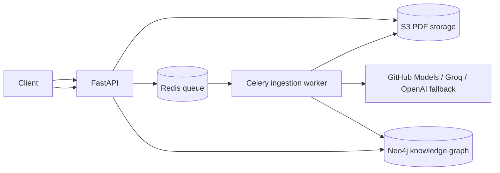

# Learning Studio

A FastAPI service that turns uploaded PDFs into a cited educational knowledge graph.

## Architecture



## Run locally

1. Copy `.env.example` to `.env` and configure credentials.
2. Start dependencies: `docker compose up --build`.
3. Open Swagger UI at `http://localhost:8000/docs`.
4. Upload a PDF:

   ```bash
   curl -F "file=@course.pdf" http://localhost:8000/api/v1/documents
   ```

### Deploying with `learning_studio` as the Vercel Root Directory

Set Vercel's **Root Directory** to `learning_studio`. That folder contains its own
`vercel.json`, `requirements.txt`, and `api/index.py` entrypoint. The entrypoint exposes
the FastAPI application while preserving package-relative imports.

Endpoints include `GET /health`, `GET /api/v1/search?q=...`, and `GET /api/v1/graph`.

The structured study experience uses:

- A startup selector for `Group` and `Textbook`, persisted with each study session.
- `POST /api/v1/sessions` to create a learning session.
- `POST /api/v1/sessions/{session_id}/chat` for context-aware, textbook-grounded chat.
- `POST /api/v1/sessions/{session_id}/questions` with `mode` set to `textbook`, `previous`, or
  `repeated` to play one question on demand.

Conversation messages and generated questions are persisted in Neo4j, so the tutor can reference
earlier questions and revisit repeated concepts with page-level citations.

To pre-generate textbook questions with local Ollama, configure `OLLAMA_MODEL` and run:

```bash
.venv/bin/python ingest_question.py --textbook "Courseware on Science and Technology.pdf"
```

The script reads direct `MENTIONS` entities from Neo4j, generates one grounded MCQ per entity,
and stores reusable `StudyQuestion` nodes. The question player will serve these stored textbook
questions immediately, without waiting for Gemini. Use `--limit` to test a small batch first.

All generated questions are four-option multiple-choice questions. Set `QUESTION_LEVEL` in `.env`
to control the target standard; the default is `Default`.

When a question has no matching local graph material, configure `GEMINI_API_KEY` and the tutor
uses Gemini as the knowledge fallback. If the graph only has a bare entity mention, Gemini Search
grounding is used with a 12-second timeout (`CHAT_FALLBACK_TIMEOUT_SECONDS` can adjust it). Local
graph results remain the preferred source.

Learning-step summaries are extracted from matching textbook passages stored on `HAS_CHUNK` nodes
or legacy source-document text. Entity mentions without a passage are not presented as summaries.

## Vector search prerequisites

Vector search is a post-extraction ingestion step: PDF text and concepts are extracted first,
then chunks are embedded and stored as `Chunk` nodes in Neo4j. Configure `OPENAI_API_KEY` (or an
OpenAI-compatible embedding endpoint) plus `EMBEDDING_MODEL` and `EMBEDDING_DIMENSIONS`. Neo4j 5
with vector-index support is required. Without embedding configuration, ingestion still completes
and search falls back to concept matching; configure embeddings before relying on semantic search.

The UI includes contextual suggestion chips and a session progress bar. Progress is based on
persisted chat messages and question-player activity rather than a hard-coded percentage.

For production, use AWS IAM roles for S3 access, private S3/Neo4j networking, TLS, a secrets manager, authentication, rate limiting, malware scanning, and ECS task definitions with separate API and worker services.
