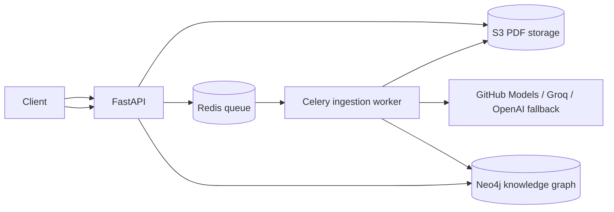

# Learning Studio

A FastAPI service that turns uploaded PDFs into a cited educational knowledge graph.

## Architecture



## Run locally

1. Copy `.env.example` to `.env` and configure credentials.
2. Start dependencies: `docker compose up --build`.
3. Open Swagger UI at `http://localhost:8000/docs`.
4. Upload a PDF:

   ```bash
   curl -F "file=@course.pdf" http://localhost:8000/api/v1/documents
   ```

### Langfuse tracing

Set `USE_LANGFUSE=true` together with `LANGFUSE_PUBLIC_KEY`, `LANGFUSE_SECRET_KEY`, and
`LANGFUSE_BASE_URL` in `.env` to enable tracing for model calls, chat/question generation,
embeddings, and background PDF ingestion. Tracing is disabled unless `USE_LANGFUSE=true`, and is
also skipped when either key is missing or `LANGFUSE_TRACING_ENABLED=false`. The API flushes
pending traces at shutdown, and the worker flushes after each document task.

Prompt, textbook, and model output content is not sent by default. Traces still include operation
names, provider/model, usage when returned by the provider, safe metadata, and content lengths. Set
`LANGFUSE_CAPTURE_CONTENT=true` only if you have reviewed the data-handling implications and want
full inputs and outputs recorded.

### Deploying with `learning_studio` as the Vercel Root Directory

Set Vercel's **Root Directory** to `learning_studio`. That folder contains its own
`vercel.json`, `requirements.txt`, and `api/index.py` entrypoint. The entrypoint exposes
the FastAPI application while preserving package-relative imports.

Endpoints include `GET /health`, `GET /api/v1/search?q=...`, and `GET /api/v1/graph`.

The structured study experience uses:

- A startup selector for `Group` and `Textbook`, persisted with each study session.
- `POST /api/v1/sessions` to create a learning session.
- `POST /api/v1/sessions/{session_id}/chat` for context-aware, textbook-grounded chat.
- `POST /api/v1/sessions/{session_id}/questions` with `mode` set to `textbook`, `previous`, or
  `repeated` to play one question on demand.

Conversation messages and generated questions are persisted in Neo4j, so the tutor can reference
earlier questions and revisit repeated concepts with page-level citations.
Guided lessons turn matching textbook passages into a connected, exam-focused summary of two or
three paragraphs instead of displaying a clipped passage excerpt. English and Telugu lesson text is
stored on the session's `ScreeningQuestion` node and switches with the language toggle.

To pre-generate textbook questions, configure the selected provider in `.env` and run:

```bash
.venv/bin/python ingest_question.py --textbook "Courseware on Science and Technology.pdf"
```

The script reads direct `MENTIONS` entities and discovers numbered chapter topics from textbook
contents pages in Neo4j. It supplies each discovered chapter's page-bounded source text to question
generation, then stores reusable `StudyQuestion` nodes with English and Telugu questions, options,
and explanations. Numbered chapter titles are read from each textbook's contents page; the matching
page-bounded text is supplied as generation evidence. Chapters whose source pages are absent from
Neo4j are logged and skipped until the PDF ingestion is complete.
Set `QUESTIONS_PER_ENTITY` in `.env` to a value from 3 to 5 (default 3). Existing questions count
toward that target; reruns generate only the missing distinct questions. English question text is used
to detect duplicates, and each question receives a stable per-question ID.
Pass `--only-zero-questions` to restrict a run to entities with no stored questions, leaving entities
with any existing questions unchanged.
Generated questions are persisted as soon as each entity finishes, so slow or rate-limited entities
do not delay storage of completed entities.
The question player reads these stored translations when the language toggle changes.
Set `USE_MODEL` to `GEMINI`, `GROK`, or `OLLAMA` to select the primary ingestion provider.
If unset, the default is `OLLAMA`, using the local `qwen2.5-1.5b-instruct:local` alias copied from
the downloaded Qwen model. Set `OLLAMA_MODEL` to an installed Ollama model name. Generation runs
through the local Ollama API at `OLLAMA_ENDPOINT`;
ingestion does not call Hugging Face. Ollama is used only when explicitly selected. Gemini can fall
back to Grok when `GROK_API_KEY` is configured; cloud-provider failures do not fall back to Ollama.
Configure
`GROK_API_KEY` for Grok; `GROK_MODEL` defaults to
`grok-4.7`. Grok HTTP
failures log the status and a truncated, API-key-redacted response body. Gemini requests time out after
60 seconds by default, return at most 768 tokens, retry transient 429 responses once, then fall back
to Grok if configured. If no cloud provider succeeds, the question is recorded as failed rather than
generated locally. A Gemini failure disables further Gemini calls
for that run. Gemini and Grok use one worker by default to reduce provider rate limiting. Grok
requests default to a 15-second timeout and a 20-second interval between requests. TPM 429 responses
are retried using the provider's suggested delay; daily token quota errors stop retrying, and malformed
bilingual outputs are regenerated up to three attempts.
Adjust `GEMINI_QUESTION_TIMEOUT_SECONDS`, `GEMINI_QUESTION_MAX_OUTPUT_TOKENS`,
`GROK_QUESTION_TIMEOUT_SECONDS`, `GROK_QUESTION_MAX_OUTPUT_TOKENS`,
`GROK_QUESTION_REQUEST_INTERVAL_SECONDS`, `QUESTION_INGEST_WORKERS`, and
`QUESTION_INGEST_BATCH_SIZE` as needed. Gemini and Grok use one worker by default to reduce provider
rate limiting; other providers use four. Explicitly selected Ollama calls are limited to one at a
time (`QUESTION_INGEST_OLLAMA_WORKERS`). Logs distinguish Ollama queue wait from model request
duration.
Neo4j reads and writes are batched. Use `--limit` to test a small batch first. The question player
serves stored questions immediately. Ingestion logs configuration (excluding credentials), entity
loading, existing-question skips, per-provider attempts/results and durations, batch
storage/results, and run totals; failures include exception details for troubleshooting.

PDF graph ingestion stops the run immediately when a provider reports an exhausted daily token
quota, rather than retrying each remaining chunk. Rerun the PDF ingestion after the provider quota
resets; completed chunks may be processed again.

For PDF-to-graph ingestion, `ingest_pdf.py` checks existing Neo4j source-document IDs and a local
`.ingested_pdf_chunks.json` checkpoint before processing each chunk. If a provider quota or another
error interrupts the run, rerunning the same PDF skips chunks already stored and continues with the
remaining chunks. The checkpoint is tied to the PDF content and selected page range.

To ingest a single bilingual previous-exam paper into Neo4j, configure `USE_MODEL` and its
provider credentials in `.env`, then run:

```bash
.venv/bin/python ingest_previous.py --pdf "/path/to/previous-paper.pdf"

```

The script extracts selectable PDF text page by page and shows progress while it stores questions
as separate `PreviousQuestion` nodes. Front matter is skipped using question/answer-choice cues.
It logs the extracted text for each page (`PDF_PAGE_TEXT`) to help diagnose PDF/OCR issues; those
logs can contain the full exam-paper content.
When the PDF text layer does not contain Telugu Unicode, pages are rendered locally and OCRed with
Tesseract's English and Telugu language packs. On macOS, install them with
`brew install tesseract tesseract-lang`. It hashes normalized question text and skips duplicates,
including on reruns. If progress ends with `questions found: 0, duplicates: 0`, no questions were
extracted; it does not mean all questions were duplicates. Retryable provider rate limits honor
`Retry-After` and are retried up to five times by default
(`PREVIOUS_INGEST_RATE_LIMIT_ATTEMPTS` and `PREVIOUS_INGEST_RATE_LIMIT_MAX_WAIT_SECONDS` configure
the retry policy). Re-ingesting a matching paper refreshes its question fields, which can clean
up older mixed-language records. Progress distinguishes questions found, added, and skipped as
duplicates.
The question player reads the English or Telugu question and options from those nodes according
to the UI language switch.

All generated questions are four-option multiple-choice questions. Set `QUESTION_LEVEL` in `.env`
to control the target standard; the default is `Default`.

When a question has no matching local graph material, configure `GEMINI_API_KEY` and the tutor
uses Gemini as the knowledge fallback. If the graph only has a bare entity mention, Gemini Search
grounding is used with a 12-second timeout (`CHAT_FALLBACK_TIMEOUT_SECONDS` can adjust it). Local
graph results remain the preferred source.

Learning-step summaries are extracted from matching textbook passages stored on `HAS_CHUNK` nodes
or legacy source-document text. Entity mentions without a passage are not presented as summaries.

## Vector search prerequisites

Vector search is a post-extraction ingestion step: PDF text and concepts are extracted first,
then chunks are embedded and stored as `Chunk` nodes in Neo4j. Configure `OPENAI_API_KEY` (or an
OpenAI-compatible embedding endpoint) plus `EMBEDDING_MODEL` and `EMBEDDING_DIMENSIONS`. Neo4j 5
with vector-index support is required. Without embedding configuration, ingestion still completes
and search falls back to concept matching; configure embeddings before relying on semantic search.

The UI includes contextual suggestion chips and a session progress bar. Progress is based on
persisted chat messages and question-player activity rather than a hard-coded percentage.

For production, use AWS IAM roles for S3 access, private S3/Neo4j networking, TLS, a secrets manager, authentication, rate limiting, malware scanning, and ECS task definitions with separate API and worker services.
